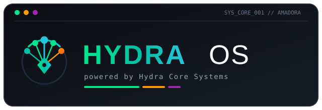

<!-- markdownlint-disable MD032 MD033-->
# 🔥 **hydra-core**

<div align="center">
    <a href="https://github.com">
    
  </a>

  <br><br>
  <a href="https://github.com/carloshmarques/hydra-core/issues">
    
  </a>
  <a href="https://github.com/carloshmarques/hydra-core/pulls">
    
  </a>
  <a href="LICENSE">
    
  </a>
</div>

---

## 🤔 **About the project**

**Hydra Core** is the central foundation of the Hydra architecture, built in C# (.NET). It provides a modular, decoupled core library alongside Console and Windows Forms interfaces, designed to manage environment drivers, configurations, and system workflows cleanly.

* **Core Engine (`Hydra.Core`):** Encapsulates business logic, data models, and environment drivers independently from the UI.
* **CLI Interface (`Hydra.Console`):** Lightweight command-line runner for automation, scripting, and headless execution.
* **Desktop Interface (`Hydra.WinForms`):** Windows Forms client for visual interaction and local management.

---

## ⚡ **Installation**

1. **Prerequisites:**
   * [.NET SDK](https://microsoft.com) (8.0 or newer recommended)
   * Git

2. **Clone the repository:**
   ```bash
   git clone https://github.com
   cd hydra-core
   ```

3. **Restore dependencies and build the solution:**
   ```bash
   dotnet restore src/Hydra.sln
   dotnet build src/Hydra.sln --configuration Release
   ```

---

## 🚀 **Usage**

* **Run the Console application:**
  ```bash
  dotnet run --project src/Hydra.Console
  ```

* **Run the Windows Forms application:**
  ```bash
  dotnet run --project src/Hydra.WinForms
  ```

---

## 🌲 **Project tree**

```text
hydra-core/
├── .github/                # GitHub workflows, issue & PR templates
├── assets/                 # Official project media and SVG diagrams
│   └── img/
├── data/                   # Official runtime data & default configurations
├── src/                    # C# Solution and source projects
│   ├── Hydra.Core/         # Core domain logic, models, and drivers
│   ├── Hydra.Console/      # Command-line interface (CLI)
│   ├── Hydra.WinForms/     # Desktop graphical interface
│   └── Hydra.sln           # Visual Studio / .NET Solution file
├── templates/              # Clean configuration and document templates
├── .gitattributes          # Cross-platform line ending rules
├── .gitignore              # Ignored build artifacts & private workspace folders
├── CHANGELOG.md            # Version history (Keep a Changelog)
├── LICENSE                 # MIT License
└── README.md               # Project documentation
```

---

## 📝 **Additional notes**

* This repository is currently in early active development (`0.x.y`). Public APIs and internal structures may evolve rapidly before `1.0.0`.
* Local workspace folders (`_data/`, `_docs/`, `_drafts/`) are intentionally excluded from version control via `.gitignore`.

---

## ⚖️📝 **License and Changelog**

* Distributed under the **MIT License**. See **[LICENSE](LICENSE)** for more information.
* Track all notable changes in **[CHANGELOG.md](CHANGELOG.md)**.

---

<div align="center">
  Made with ❤️ by <a href="https://github.com/carloshmarques">@carloshmarques</a>
</div>
